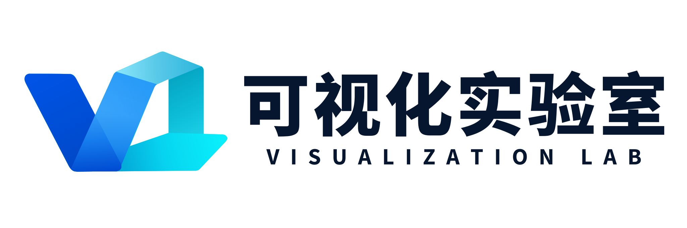
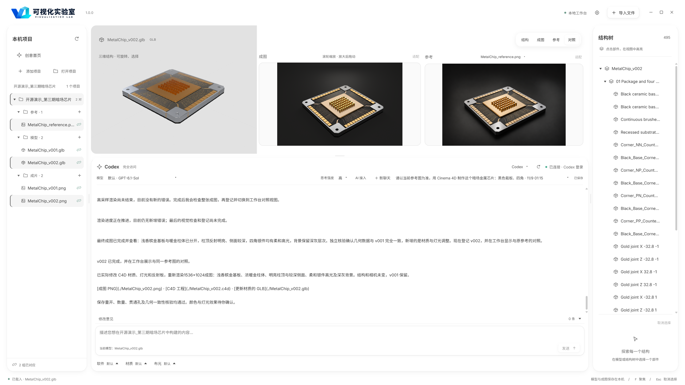
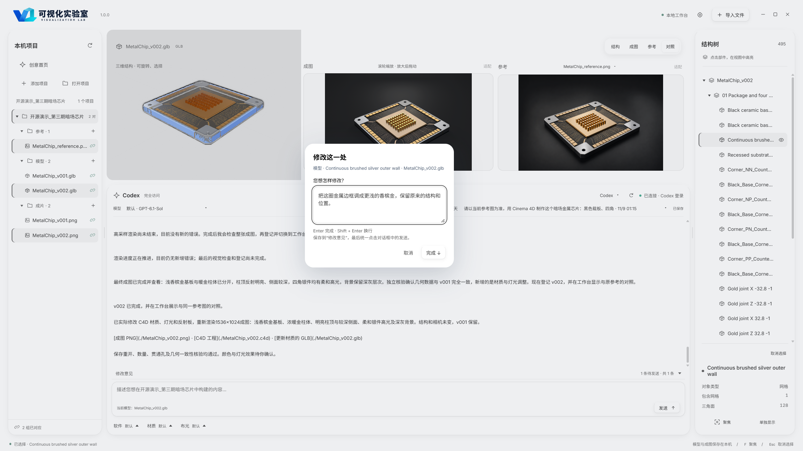
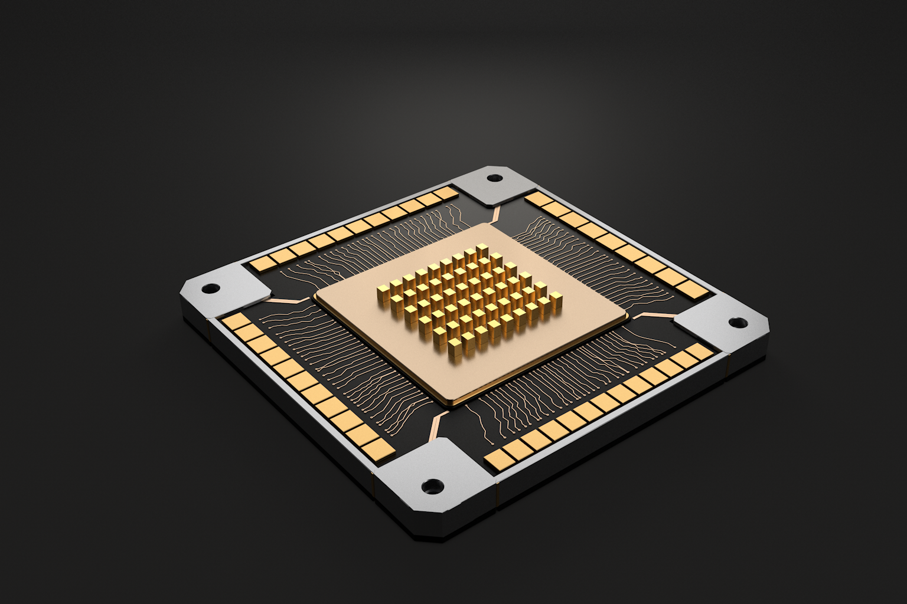
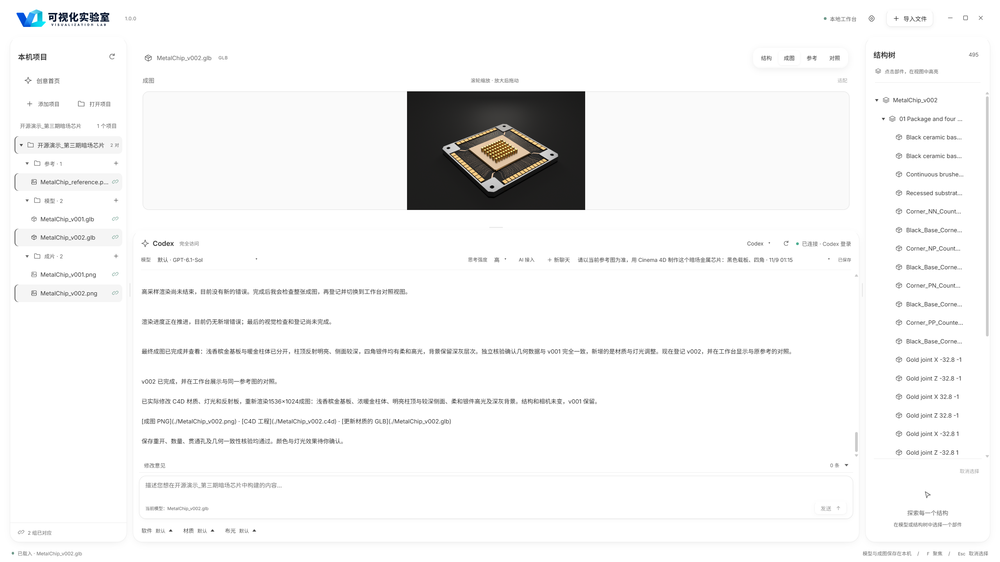

<p align="center">
  
</p>

# 可视化实验室

把参考、模型和成图放在同一个工作台里。

可视化实验室是我在做的一个本地创作工作台。画图时，参考图、建模软件和聊天窗口往往各在一处；我想把这些环节接起来，让你一边看效果，一边和 AI 讨论怎么改，参考、工程和修改记录都按项目保存在本机。

**1.0.0 先提供三维建模与成图工作流，目前支持 Blender 和 Cinema 4D。** 数据绘图会放在后续版本里。

### [↓ 下载 Windows 版 · 1.0.0](https://github.com/ZHP0226/visualization-lab/releases/download/v1.0.0/VisualizationLab-v1.0.0-windows-x64.zip)

Windows 10 / 11，64 位，解压后即可打开。

[版本下载页](https://github.com/ZHP0226/visualization-lab/releases) · [使用指南](docs/使用指南.md) · [完整案例](examples/dark-metal-chip/README.md) · [反馈问题](https://github.com/ZHP0226/visualization-lab/issues)

[](docs/images/workbench-fullscreen-light.png)

*上图是实际工作台的浅色全屏截图，点开可以查看原图。参考、模型和成图放在一起，修改时方便对照。*

## 想改哪里，就在那一处右击

在三维视图或右侧结构树里右击部件，或者在成图、参考图上右击某个位置，就能填写这一处的修改要求。例如：“把这圈金属边框调成更浅的香槟金，保留原来的结构和位置。”

1. **右击选中要改的地方**，写下要求。
2. 点 **“完成”**，意见会保存到聊天区上方的“修改意见”里。可以先标记几处，也能点开之前的意见继续编辑。
3. 最后统一点 **“发送”**，让连接的 AI 根据这些对象和位置继续处理。

[](docs/images/right-click-edit-fullscreen-light.png)

*右击负责选定位置和记录意见；点击发送后，AI 才开始执行修改。*

## 先看看能做出什么

下面是随软件附带的暗场金属芯片案例，用 Cinema 4D 建模并实际渲染。包里保留了参考图、两版工程、成图、复现脚本，以及在工作台中完成制作的真实对话记录。



你可以打开 `.glb` 查看结构，也可以用 C4D 打开同名 `.c4d` 继续修改。完整制作对话以 [Markdown 记录](examples/dark-metal-chip/dark-metal-chip-demo/制作对话记录.md) 随案例提供，方便边看边对照。[查看案例文件和复现方法](examples/dark-metal-chip/README.md)。

[](docs/images/workbench-render-fullscreen-light.png)

*成图和制作对话保存在同一个项目下。想继续改颜色、材质或灯光，可以接着已有对话往下做。*

## 下载以后怎么用

**先打开软件。** 下载上面的 Windows 压缩包，完整解压到一个文件夹，运行里面的 `可视化工作台.exe`。旁边的资源文件要一起保留。

**再看附带的例子。** 将 `examples/dark-metal-chip` 整个文件夹复制到自己的工作目录，在软件左侧点“打开项目”，选择其中的 `dark-metal-chip-demo`。点击 `MetalChip_v002.glb`，再切换“对照”，就能同时看到结构、成图和参考。浏览这个例子不需要先连接 AI，也不需要安装 C4D。

**想自己做图时，再连接 AI。** 软件会检测本机 Agent，也有手动配置程序和 API 的入口。连接后，新建自己的项目，放入参考图，说明想做什么、哪些地方要保留，再逐步检查和修改。当前可以接入 Codex、Claude Code、Gemini CLI、OpenCode；不同连接实际能做什么，取决于它的模型、工具和权限。

AI 账户、API 额度和需要调用的建模软件由你自己准备。要重新制作附带的芯片案例，需要安装 C4D；用 Blender 做自己的项目，也需要先安装 Blender。[详细操作见使用指南](docs/使用指南.md)。

## 工作台里可以做什么

| 想做的事 | 对应的操作 |
| --- | --- |
| 整理一张图的制作资料 | 按项目保存参考、模型和成图，并关联到具体版本 |
| 检查模型和效果 | 预览 GLB / glTF、FBX、OBJ；切换结构、成图、参考和对照视图 |
| 右击局部修改 | 右击三维部件、结构树或图片位置，保存修改要求，再统一发送给 AI |
| 接着之前的工作往下做 | 保留项目聊天、修改记录和已交付版本 |
| 调整成自己顺手的界面 | 切换浅色 / 深色，调整字号和面板大小 |

## 想看实际操作，可以关注我

抖音搜索 **潸海同学**。可视化实验室的操作演示、做图过程和后续更新，会放在那里。

软件由我个人维护，GitHub 账号是 [ZHP0226](https://github.com/ZHP0226)。使用中遇到问题，可以在 [Issues](https://github.com/ZHP0226/visualization-lab/issues) 留言，写一下版本、点了什么、出现什么情况，附上截图会更容易排查。

## 开源与使用统计

自写代码和自制资产采用 [MIT 许可](LICENSE)，可以修改、分发和商用，分发时保留许可与版权声明。字体、运行库等第三方内容保留各自许可，详见 [第三方声明](THIRD-PARTY-NOTICES.md)。示例中的尺寸是可视化示意，不是实验或仿真数据。

首次打开时，你可以选择是否参与使用统计。同意后，软件会向 PostHog（美国）发送随机安装标识、软件版本、系统类型和使用日期，用来了解首次使用和每天的活跃安装情况；取消仍可正常使用，也能随时在设置里关闭。统计不包含聊天、项目内容、文件路径或 API 密钥。[查看隐私与本地数据说明](docs/隐私与本地数据.md)。

<details>
<summary>想自己改代码：源码运行与打包</summary>

已验证 Windows x64、Node.js 24.20.0、Electron 45.2.1。依赖版本固定在 `package-lock.json`，在源码目录运行：

```powershell
npm ci
npm run setup:runtime
npm run build
npm test
npm run dev
```

`dev` 使用独立的 `.local` 用户配置，测试统计只写本地；`npm start` 使用正常用户配置。运行库安装需要联网，网络中断时可重试。

打包需要 Python 3，执行 `npm run build` 和 `npm run package`，输出为 `release/VisualizationLab-v1.0.0-windows-x64`。已有目录不会覆盖，可通过 `--out` 指定新位置。自行分发修改版时，请将统计配置换成自己的项目或清空 token。

[开发与构建](docs/开发与构建.md) · [本地验证记录](docs/本地验收.md) · [参与贡献](CONTRIBUTING.md) · [1.0.0 发布说明](CHANGELOG.md)

</details>
