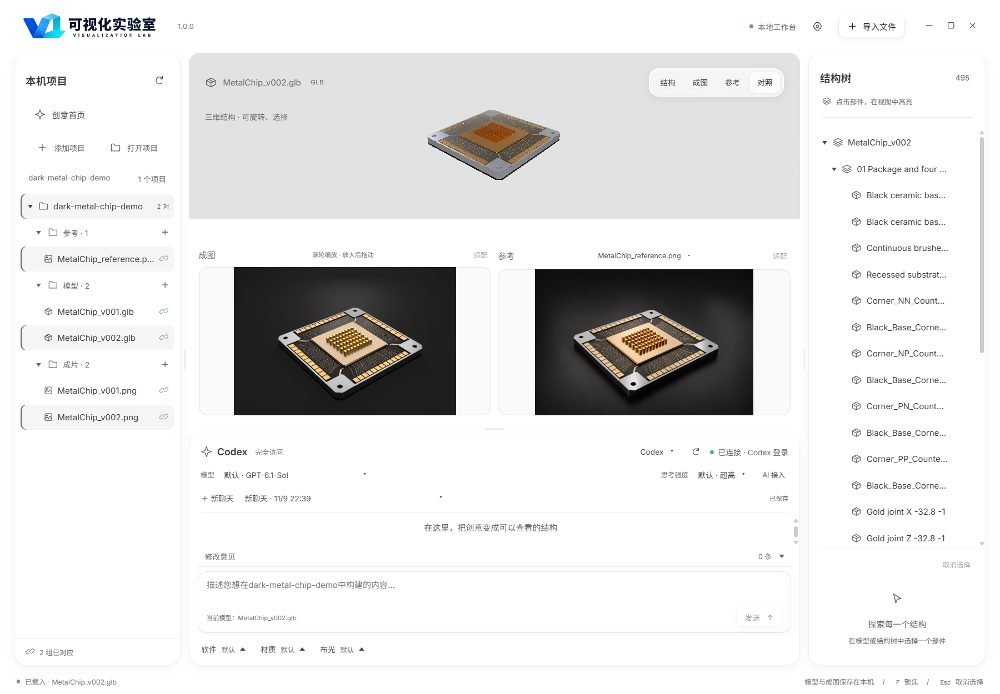

# 本地验收 · 1.0.0

验证日期：2026-11-09。平台：Windows x64、Node.js 24.20.0、Electron 45.2.1。主要案例为第三期暗场金属芯片 C4D 工程。

| 检查 | 结果 |
| --- | --- |
| 锁定依赖安装、源码构建 | 通过 |
| 单元回归 | 125 项通过，无失败或跳过 |
| 源码与 Windows 版界面 | 各 13 项检查通过 |
| 右击局部修改 | 三维视图、结构树、成图、参考图定位，以及意见保存和恢复通过；靠边弹窗保持在视口内 |
| 项目恢复与对照 | 恢复两版模型、参考及成图；495 个网格，三种内容可同时查看 |
| 浅色 / 深色与设置 | 通过 |
| 官方统计配置 | 源码和 Windows 版均为 PostHog 美国区项目 719835 |
| 统计选择 | 首次同意、首次取消、设置启用、重启去重及设置关闭均通过 |
| 测试事件 | 版本 1.0.0、仅本地捕获；未向云端增加测试用户 |
| 版本元数据 | 应用版本 1.0.0，EXE 产品版本 1.0.0、文件版本 1.0.0.0 |

## 示例

案例实际通过工作台中的真实 Codex 对话完成，保留三轮用户请求和完整回复，以及 v001 / v002 工程、复现脚本与实际 PNG / PDF。C4D 原生保存重开、纹理依赖和结构检查已完成：54 根金属柱、44 个触点、4 个贯通安装孔、495 个导出网格。v002 保留 v001 几何与相机，更新材质、灯光和渲染。

## 验证范围

C4D 案例在 R21 21207 / Standard 渲染器中验证；其他版本和其他 Agent 未逐一实跑。GLB 使用近似 PBR 材质，原生反射效果以 C4D 工程及 PNG 为准。示例为可视化演示，不是实验、仿真或工艺数据；PDF 为真实渲染的单页位图。

本轮安装锁定依赖后完成构建与测试，Electron 使用已核验的本机同版本运行库；未重新验证从零下载 Electron 的网络过程。自动检查使用示例副本和独立配置，不调用付费 AI，也不向真实统计服务发送测试事件。
