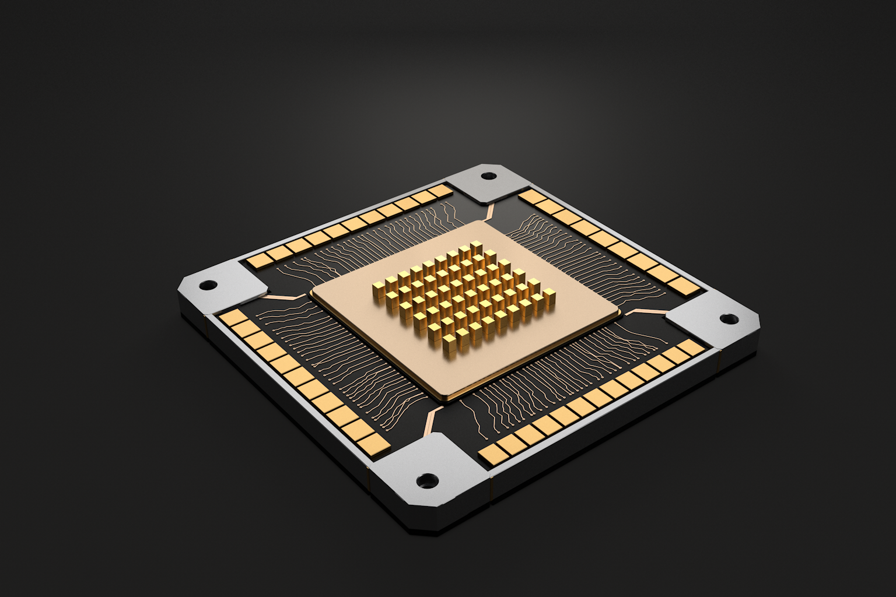
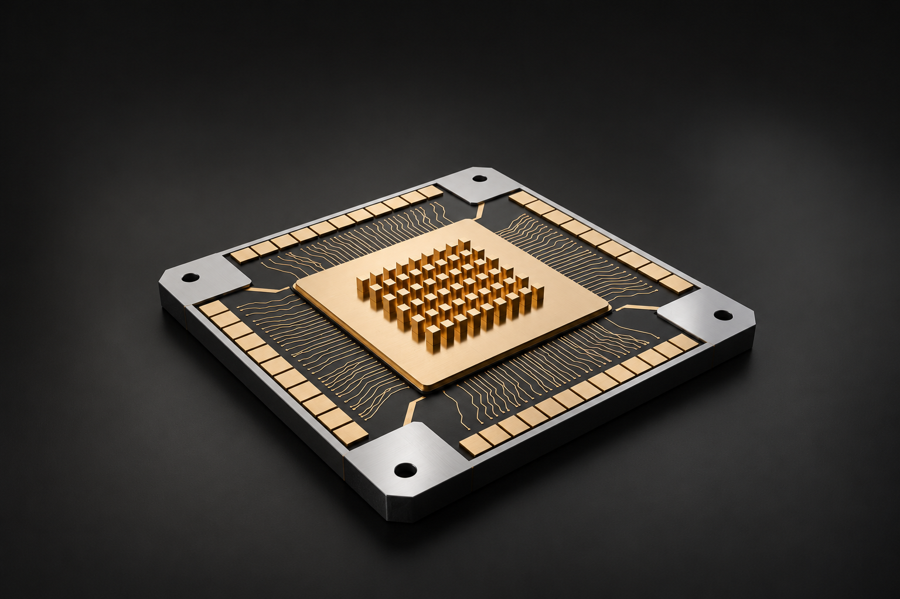

# 第三期暗场金属芯片 · 真实工作台流程

本案例以可视化实验室第三期《建模灯光》的暗场芯片为视觉方向，先生成参考，再在工作台中通过真实 Codex 对话执行 Cinema 4D 建模、检查、调色布光和渲染。当前保留 v001 与调色后的 v002。



## 在工作台查看

复制本例后打开 `dark-metal-chip-demo`，选择 `MetalChip_v002.glb` 并切换“对照”。参考、两版模型与两版成图已经关联。用 C4D 打开同前缀 `.c4d`，迁移时保留 `tex`。



## 真实对话

[制作对话记录](dark-metal-chip-demo/制作对话记录.md) 为工作台保存消息的原样导出，包含方案分析、第一版制作、调色布光、试片检查和正式交付。没有补写 AI 回复。公开包包含导出记录，作者本机的原聊天数据库、原生会话及登录配置不在包内；导入示例不会向另一台机器伪造历史聊天。

本次实跑也发现并修复了“完成可编辑模型和暗场成图”被误判为图片任务的问题。修复后继续了同一真实会话；此前的尝试和恢复过程保留在记录中。

## 文件与复现

| 文件 | 内容 |
| --- | --- |
| `MetalChip_reference.png` | 按第三期暗场画面生成的参考 |
| `MetalChip_v001.c4d/.glb/.png/.pdf` | 真实工作台执行的第一版 |
| `MetalChip_v002.c4d/.glb/.png/.pdf` | 原生 C4D 调色、布光后重新渲染的第二版 |
| `MetalChip_v001_reproduction` | 自写程序化几何、参数、纹理、检查与审计 |
| `MetalChip_v002_reproduction` | 实际材质与灯光参数、脚本、几何比较及审计 |
| `制作对话记录.md/.json` | 本次真实工作台会话导出 |

已验证 Cinema 4D R21 21207 / Standard 渲染器，不要求额外渲染插件，C4D 软件和可用许可需自行准备。

R21 内置 Python 2.7，建议复制到无中文路径。在 v001 复现目录执行（换成自己的程序与新输出位置）：

```powershell
& 'C:\你的C4D目录\c4dpy.exe' .\build_scene.py --final --output-dir=C:\VLExamples\chip-base
```

在 v002 复现目录，可直接以附带的第一版原生工程为基础，重做真实材质与布光：

```powershell
& 'C:\你的C4D目录\c4dpy.exe' .\match_scene.py --source=C:\VLExamples\chip-base\MetalChip_v001.c4d --settings=look-settings.json --output-dir=C:\VLExamples\chip-look
```

渲染较慢，正式质量在本机约需数分钟；不要在已有确认工程上测试覆盖。GLB 导出使用复现目录的 `export_native.py`，其实际运行方式与审计见该目录 README。原始审计中的绝对路径表示本次执行位置，跨机器复现时使用自己的路径。

主要检查：54 根柱、44 个触点、4 个真实贯通安装孔、122 条细走线和 495 个独立网格。v002 的几何与相机和 v001 一致，变化在材质、灯光和摄影棚环境。GLB 使用近似 PBR，精细反射以 C4D 工程和真实 PNG 为准。颜色与灯光是本轮匹配结果，仍供用户最终目检，不声称逐像素一致。

可选 PDF 由实际 PNG 包装为单页 300 dpi 位图，运行 `python export_pdf.py 输入.png 输出.pdf`，需要 `pillow reportlab`。

代码、纹理、模型、渲染为本项目自制，按根目录 MIT 提供；参考图的实际提示词保存在 `MetalChip_v001_reproduction/prompt.txt` 中。案例尺寸是可视化示意，不是工艺、测量或仿真数据。C4D 本体不随包分发。
