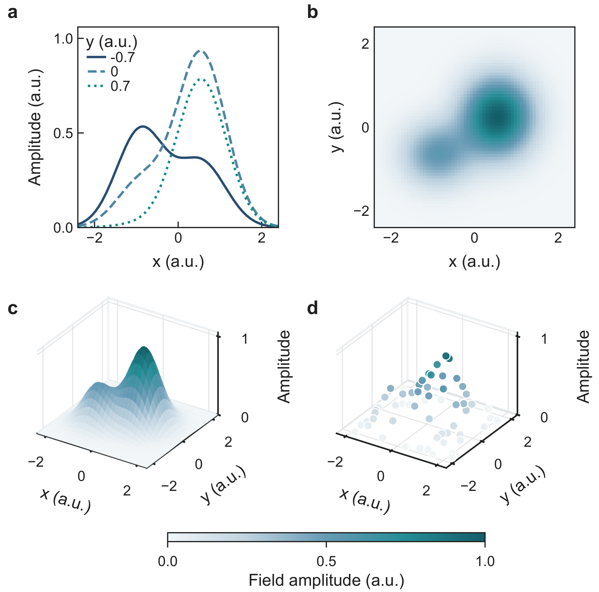

# Nature 风格单栏四分图

整图 89 × 88 mm，2 × 2 紧凑排版，统一蓝—青配色。全部数据是确定性合成数据，用来演示绘图功能，不是实验结果。

| 分图 | 模板 | 内容 |
| --- | --- | --- |
| a | 1 | 二维截线曲线 |
| b | 41 | 二维标量场 |
| c | 43 | 三维曲面 |
| d | 45 | 三维散点 |

Arial；正文 7 pt、刻度 6 pt、分图标号 8 pt；曲线 1 pt、坐标框 0.5 pt。b/c/d 共用 0–1 归一化场幅值配色。

将本目录复制到自己的工作目录，在软件中点“打开项目”，选择 `nature-four-panel-demo`，再点击左侧四分图即可查看。预览不需要先连接 AI。四个分图各有数据表，选中数据列可以定位相应绘图代码。预览中的毫米标尺与网格可关闭，不会进入导出文件。

项目的 `figures/1a0127ff-0a6d-405a-bee1-31abd428432f/revisions/0001` 包含 `数据.xlsx`、`绘图.py`、`图.pdf`、`图.svg`、`预览.png` 和辅助模块。安装 Python 3 与 NumPy、SciPy、Matplotlib、scikit-learn 后，也可以在该目录执行 `python 绘图.py`；修改前请复制示例。请保留同目录辅助文件。

Nature 风格是软件的固定外观预设，投稿前仍应核对目标期刊当次要求。
